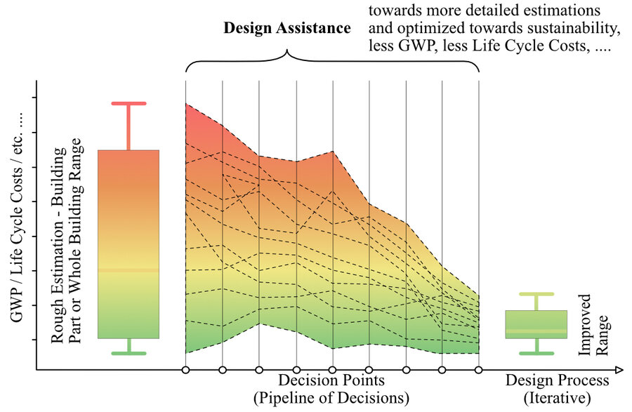
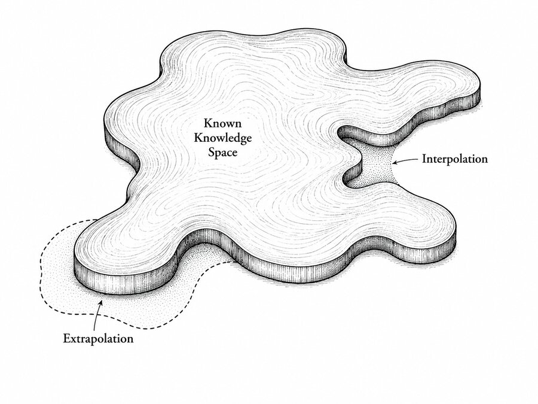
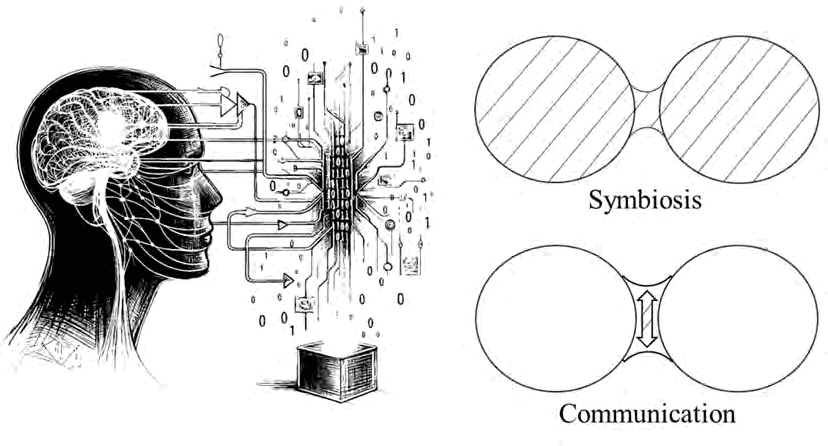
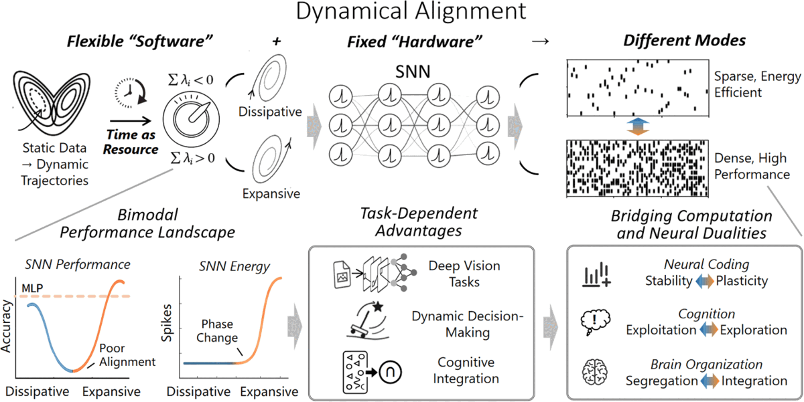

<section class="hv-hero">

I study <strong>Human-AI Alignment</strong>: how AI systems can keep people’s decisions, knowledge and attention in the loop, so that they extend what people can understand, decide and discover.

Postdoctoral Fellow at the <a href="https://www.mdsi.tum.de/mdsi/startseite/">Munich Data Science Institute</a> and the <a href="https://www.mdsi.tum.de/gni/startseite/">Georg Nemetschek Institute</a>, Technical University of Munich, selected through the TUM GNI Postdoc Program.

<a href="/publications/">Publications</a><a href="/year-archive/">Blog</a><a href="/cv/">CV</a><a href="https://scholar.google.com/citations?user=dNEQ7yYAAAAJ&hl=en">Google Scholar</a>

<figure class="hv-art"></figure>
</section>
<h2 class="hv-h">Four alignments</h2>

<a class="hv-card" href="/publications/#alignment-a">A<b>Decision-making process alignment</b>Model assistance that follows how people decide under uncertainty.{{ n }} papers</a><a class="hv-card" href="/publications/#alignment-b">B<b>Methodological paradigm alignment</b>Knowledge-integrated machine learning in three levels: interpolation, extrapolation, representation.{{ n }} papers</a><a class="hv-card" href="/publications/#alignment-c">C<b>Interaction pattern alignment</b>Outputs people can read and check, and a wider bandwidth between person and machine.{{ n }} papers</a><a class="hv-card" href="/publications/#alignment-d">D<b>Fundamental mechanism alignment</b>How the temporal dynamics of inputs shape what a neural system computes.{{ n }} papers</a>

My doctoral dissertation, "*Beyond Predictions: Alignment between Prior Knowledge and Machine Learning for Human-centered Augmented Intelligence*", established the first three alignments as a top-down framework for integrating human and domain knowledge into data-driven systems; my postdoctoral research adds the fourth, bottom-up line on the mechanism of computation. Most of this work is tested in engineering, above all building energy and early-stage design; AI for Science is a growing second field. [Thesis](https://doi.org/10.15488/17976) · [Video](https://youtu.be/rwQaqewhqSw?si=abgUfUtCfdcIhGmH)

I received my Dr.-Ing. *summa cum laude* from Leibniz University Hannover, with doctoral research at TU Berlin and Leibniz University Hannover, supervised by [Prof. Dr.-Ing. Philipp Geyer (Heisenbergprofessor)](https://www.iek.uni-hannover.de/de/ngs/team/prof-dr-philipp-geyer) and [Prof. Dr. rer. nat. Marius Lindauer](https://www.ai.uni-hannover.de/de/lindauer). In early 2024, I was a Visiting Scholar at the [Center for the Built Environment (CBE)](https://cbe.berkeley.edu/), UC Berkeley, exploring causal inference and AI ethics in engineering reasoning.

I am also a photographer, capturing the balance between light, motion, and silence: [gallery](https://500px.com/chatchan92).

Beyond formal publications, I also write about the broader implications of AI alignment:
- [*What Cannot Yet Be Ruled Out*](/posts/2026/06/what-cannot-yet-be-ruled-out/): on bounded rationality, irreducible uncertainty, and what AI alignment must preserve.
- [*AI Systems Are Developing Swarm Autonomy. That's Enough to Be Dangerous.*](/posts/2026/02/swarm-autonomy/): on emergent coordination in multi-agent systems and the case for proto-agency as a safety concern.
