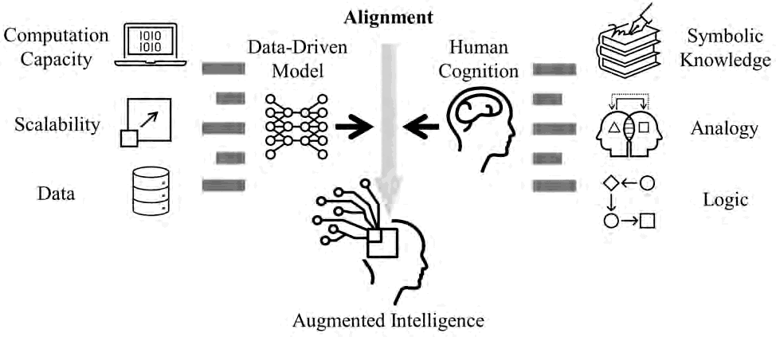

I am a Postdoctoral Fellow at the [Munich Data Science Institute](https://www.mdsi.tum.de/mdsi/startseite/) and the [Georg Nemetschek Institute (GNI)](https://www.mdsi.tum.de/gni/startseite/), Technical University of Munich, selected through the TUM GNI Postdoc Program.

I study Human-AI Alignment: how AI systems can keep people's decisions, knowledge and attention in the loop, so that they extend what people can understand, decide and discover.

My doctoral dissertation, "*Beyond Predictions: Alignment between Prior Knowledge and Machine Learning for Human-centered Augmented Intelligence*", established three alignments as a top-down framework for integrating human and domain knowledge into data-driven systems. My postdoctoral research adds a fourth, bottom-up line on the mechanism of computation:

- *Decision-Making Process Alignment*: model assistance that follows how people decide under uncertainty.
- *Methodological Paradigm Alignment*: knowledge-integrated machine learning in three levels, interpolation, extrapolation and representation.
- *Interaction Pattern Alignment*: outputs people can read and check, and a wider bandwidth between person and machine.
- *Fundamental Mechanism Alignment*: how the temporal dynamics of inputs shape what a neural system computes.

Most of this work is tested in engineering, above all building energy and early-stage design; AI for Science is a growing second field. My [publications](/publications/) are grouped by these four alignments.

[Thesis](https://doi.org/10.15488/17976) | [Video](https://youtu.be/rwQaqewhqSw?si=abgUfUtCfdcIhGmH)

I received my Dr.-Ing. *summa cum laude* from Leibniz University Hannover, with doctoral research at TU Berlin and Leibniz University Hannover, supervised by [Prof. Dr.-Ing. Philipp Geyer (Heisenbergprofessor)](https://www.iek.uni-hannover.de/de/ngs/team/prof-dr-philipp-geyer) and [Prof. Dr. rer. nat. Marius Lindauer](https://www.ai.uni-hannover.de/de/lindauer). In early 2024, I was a Visiting Scholar at the [Center for the Built Environment (CBE)](https://cbe.berkeley.edu/), UC Berkeley, exploring causal inference and AI ethics in engineering reasoning.

Beyond formal publications, I also write about the broader implications of AI alignment:
- [*What Cannot Yet Be Ruled Out*](https://www.linkedin.com/pulse/what-cannot-yet-ruled-out-xia-chen-b1jvf/): on bounded rationality, irreducible uncertainty, and what AI alignment must preserve.
- [*AI Systems Are Developing Swarm Autonomy. That's Enough to Be Dangerous.*](https://www.linkedin.com/pulse/ai-systems-developing-swarm-autonomy-thats-enough-dangerous-xia-chen-qgaof/): on emergent coordination in multi-agent systems and the case for proto-agency as a safety concern.

I am also a photographer, capturing the balance between light, motion, and silence: [gallery](https://500px.com/chatchan92).
