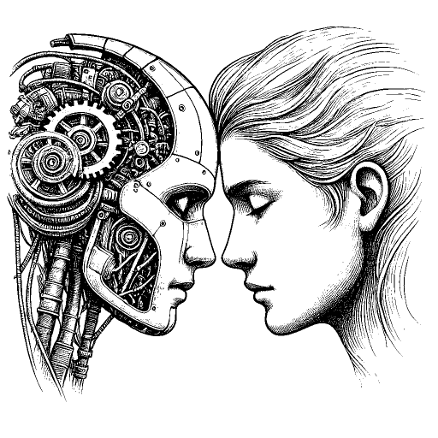

<section class="hv-hero">

I investigate <strong>Human-AI Alignment</strong>: how AI systems can keep people’s decisions, knowledge and attention in the loop, so that they extend what people can understand, decide and discover.

Postdoctoral Fellow at the <a href="https://www.mdsi.tum.de/mdsi/startseite/">Munich Data Science Institute</a> and the <a href="https://www.mdsi.tum.de/gni/startseite/">Georg Nemetschek Institute</a>, Technical University of Munich, selected through the TUM GNI Postdoc Program.

<a href="/year-archive/">Research blog</a><a href="/publications/">Publications &amp; works</a><a href="/cv/">CV</a><a href="https://scholar.google.com/citations?user=dNEQ7yYAAAAJ&hl=en" target="_blank" rel="noopener">Google Scholar</a>

<figure class="hv-art"></figure>
</section>
<h2 class="hv-h">Four alignments</h2>
<section class="xr" data-ui="cards" data-limit="8">

<button type="button" class="xr-card" data-k="A" aria-pressed="false" data-tip="Model assistance that follows how people decide under uncertainty.">A<b>Decision-making process</b>{{ n }} works</button><button type="button" class="xr-card" data-k="B" aria-pressed="false" data-tip="Knowledge-integrated machine learning in three levels: interpolation, extrapolation, representation.">B<b>Methodological paradigm</b>{{ n }} works</button><button type="button" class="xr-card" data-k="C" aria-pressed="false" data-tip="Outputs people can read and check, and a wider bandwidth between person and machine.">C<b>Interaction pattern</b>{{ n }} works</button><button type="button" class="xr-card" data-k="D" aria-pressed="false" data-tip="Bringing the fundamental mechanisms of machine learning closer to those of the human brain.">D<b>Fundamental mechanism</b>{{ n }} works</button>

Applied in

<button type="button" class="hex hx-eng" data-d="ese" aria-pressed="false" data-tip="AI for engineering" style="left:0px;top:57px">Energy system engineering<em>{{ n }}</em></button><button type="button" class="hex hx-eng" data-d="ad" aria-pressed="false" data-tip="AI for engineering" style="left:104px;top:0px">Architecture design<em>{{ n }}</em></button><button type="button" class="hex hx-su" data-d="su" aria-pressed="false" data-tip="AI for sustainability and materials science" style="left:104px;top:114px">Sustainability<em>{{ n }}</em></button><button type="button" class="hex hx-be" data-d="be" aria-pressed="false" data-tip="AI for the built environment" style="left:208px;top:57px">Built environment<em>{{ n }}</em></button><button type="button" class="hex hx-su" data-d="md" aria-pressed="false" data-tip="AI for sustainability and materials science" style="left:208px;top:171px">Material discovery<em>{{ n }}</em></button><button type="button" class="hex hx-be" data-d="hf" aria-pressed="false" data-tip="AI for the built environment" style="left:312px;top:0px">Human factor analysis<em>{{ n }}</em></button><button type="button" class="hex hx-bm" data-d="bm" aria-pressed="false" data-tip="AI for medicine" style="left:312px;top:114px">Biomedical application<em>{{ n }}</em></button>
<ul class="hex-legend"><li class="hx-eng"><i></i>AI for engineering</li><li class="hx-be"><i></i>AI for the built environment</li><li class="hx-su"><i></i>AI for sustainability and materials science</li><li class="hx-bm"><i></i>AI for medicine</li></ul>

<button type="button" data-mode="all" aria-pressed="true">all selected</button><button type="button" data-mode="any" aria-pressed="false">any selected</button>
<button type="button" class="xr-clear" hidden>Clear</button>



<button type="button" class="xr-all">Show all {{ site.publications.size }} works</button>

</section>
<h2 class="hv-h">Open-source tools</h2>


I received my Dr.-Ing. *summa cum laude* from Leibniz University Hannover, after doctoral research at TU Berlin and Leibniz University Hannover with [Prof. Dr.-Ing. Philipp Geyer](https://www.iek.uni-hannover.de/de/ngs/team/prof-dr-philipp-geyer) and [Prof. Dr. rer. nat. Marius Lindauer](https://www.ai.uni-hannover.de/de/lindauer); the dissertation, *Beyond Predictions* ([thesis](https://doi.org/10.15488/17976) · [video](https://youtu.be/rwQaqewhqSw?si=abgUfUtCfdcIhGmH)), set out the first three alignments. In early 2024, I was a Visiting Scholar at the [Center for the Built Environment (CBE)](https://cbe.berkeley.edu/), UC Berkeley, exploring causal inference and AI ethics in engineering reasoning. In 2026, I was an Invited Scholar at the Summer Institute on Bounded Rationality, [Max Planck Institute for Human Development](https://www.mpib-berlin.mpg.de/en), Berlin.

I am also a photographer, capturing the balance between light, motion, and silence: [gallery](https://500px.com/chatchan92).

<h2 class="hv-h" id="news">News</h2>
<ul class="hv-news"><li>{{ p.date | date: "%b %Y" }}{{ p.date | date: "%Y" }}<i class="fas fa-pen-nib" data-tip="Blog post" aria-label="Blog post"></i><i class="fas fa-flask" data-tip="{{ p.kind }}" aria-label="{{ p.kind }}"></i><i class="fas fa-microphone-alt" data-tip="{{ p.type }}" aria-label="{{ p.type }}"></i><a href="{{ p.link }}" target="_blank" rel="noopener">{{ p.title }}</a>{{ p.note }}<a href="{{ p.url }}">{{ p.title }}</a>{{ p.excerpt | strip_html | strip }}{{ p.title }}, <i>{{ p.venue }}</i></li></ul>

