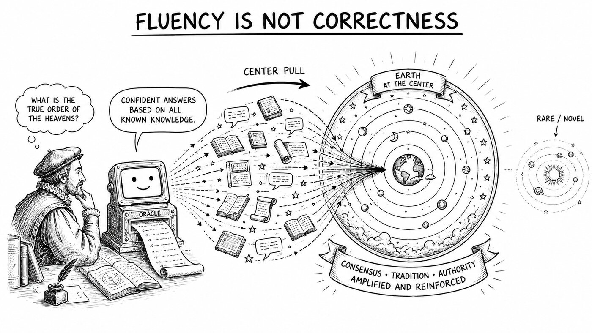
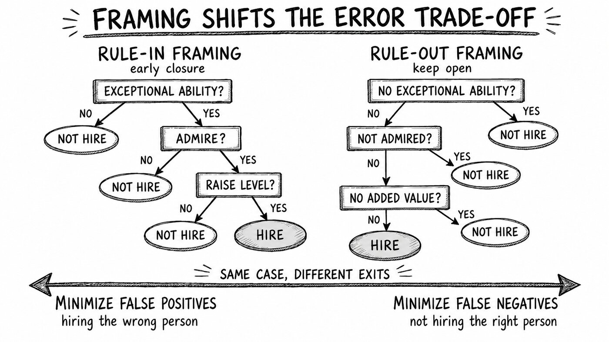
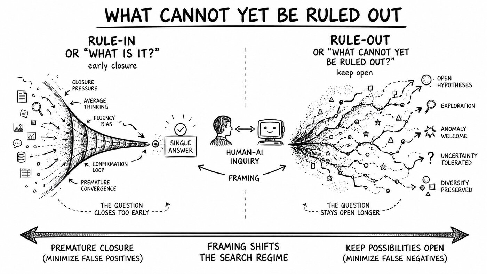

For two weeks this June, I was in Berlin at the Summer Institute on Bounded Rationality, whose theme this year was decision-making in the age of AI. Between talks, I asked Ralph Hertwig what the field was still missing. His answer stayed with me. Most research, he said, treats decisions as *slices*: a single isolated choice, frozen, its probabilities already marked. The harder and more worthwhile object is the *continuous flow*, how real decisions unfold over time as we sample, learn, and revise. The methods are mature on the slice; the open questions live on the flow side.

I have kept thinking about that distinction since, because it frames one of the central questions of human-AI collaboration: What happens to human judgment when a machine takes on part of the reasoning for us?

## The machine looks like a "kind" environment

The common worry about AI is that it pulls us toward the average: a large language model (LLM) agent produces text shaped largely by the distribution of the data it was trained and fine-tuned on; it is most stable in the dense middle of that distribution and loses calibration in the sparse tails. So the real effect is not that AI makes us mediocre. It is more like an echo: the system reflects back a version of your input pulled toward the mode, and its fluency creates an illusion of confirmation, weakens your own judgment, and so reinforces your drift toward the average.

Tomás Lejarraga's talk was a reminder of how much our picture of human rationality has depended on method: many of the heuristics-and-biases tradition's verdicts on human irrationality came from described problems, and decisions made from experience often look different, sometimes reversing the effect. The slice, in other words, was a methodological choice, not a fact about the world. What matters, then, is the environment one learns from, and Robin Hogarth's distinction gives it a vocabulary: an environment is *kind* when its feedback is representative enough to build a reliable model, and *wicked* when feedback is sparse, delayed, or misleading, so that experience leads one to the wrong conclusion.

By this measure, interaction with an AI agent has the surface texture of a kind environment and the deeper structure more of a wicked one: the feedback you get is *fluency*, not *correctness*. A confident, well-organized answer looks like a representative signal from the average or a reflection of your own thought, when it is really a sample drawn toward the center of what the model has seen. As many people come to rely on the same system, the diversity of views that makes a collective's judgment accurate narrows. The danger is that the machine's kindness is concentrated in the dense middle and appears to turn misleading in the sparse tails, where the rare and the novel live, while it keeps pulling people back toward the average. 

*A pre-Galilean AI would likely have reinforced the geocentric consensus, showing how fluent feedback can pull thought toward the dense center while marginalizing rare but transformative alternatives.*

## A fork: contraction or expansion?

At the group level, the same echo brings human-AI interaction to a fork: Down one branch, many people draw on the same upstream source, their judgments become correlated, and the group contracts toward the center. Down the other, it expands the group's frontier. Levin Brinkmann's research touches both sides. His "delve effect" example shows passive exposure to AI measurably shifting human language without intending it, consistent with the drift toward the center; his "AlphaGo effect" example shows that sufficiently good machine strategies, when learnable and clearly advantageous, can expand the frontier of human problem-solving. The same interaction can extend human capacity or narrow it. I guess the deeper question in here is: What decides which branch is taken is whether the interaction carries any productive friction.

Stefan Herzog and Ralph Hertwig make this concrete with a pair of terms, *boosting* and *nudging*: what, exactly, does the AI hand you? When it gives a recommendation outright, with a seemingly complete rationale, what you get is a finished conclusion. One that carries its own justification is easily accepted as is; it feeds confirmation bias and anchoring and does little to build your own judgment. That is nudging. When what you get is decision-relevant information, or the means to obtain it, the judgment stays yours, and your competence is built up in the process. That is boosting. Today's AI is mostly built to deliver answers quickly, leaning toward nudging; safety-critical judgment needs the opposite. The real design fork is whether the AI delivers a conclusion or the means of reaching one.

## Rule-in and rule-out: putting the collaboration mode into how you ask

There is a concrete instance: Fast-and-frugal tree, a deliberately simple decision tree. It checks a few cues one at a time, each carrying an exit, so a decision can be reached at any step. What sets such a tree's error profile, the trade-off between sensitivity and specificity, is its *exit structure*, where the branches exit, not how good the cues are. The framing of a question is itself an exit structure: Asked in a rule-in way, "Is X the case?", a "no" prunes the hypothesis and leans toward precision; asked in a rule-out way, "Can X be safely excluded?", the same "no" preserves it and leans toward recall. The identical answer, solely because the exit structure differs, shifts the balance of false positives and false negatives. So framing does not by itself fix precision or recall, but through the exit structure it systematically tilts the trade-off.

In safety-critical screening, this maps directly onto the cost of missing a rare but serious case. Berger and Zöller's work on human-AI diagnosis offers a reference point: the AI and the physician each produce a result, and a human makes the final call. This is only one possible arrangement, which raises an untested question: with a different arrangement, say letting the AI rule out possibilities, or giving the AI the final decision, would the combination perform appreciably differently?

With that, I think there are already clues, how a question is framed is itself a choice of collaboration mode: Rule-in hands you a ready-made conclusion and closes the question, which makes premature closure more likely and so often manifests as nudging; rule-out hands you the not-yet-excluded possibilities and asks you to judge which to drop, which keeps the hypothesis space open and, under the right design, can become a form of boosting. Keeping a single question from closing too early is therefore also a way of preserving diversity in the group. 

*Konstantinos Katsikopoulos — Operationalizing Bounded Rationality*

## Two regimes, one open question

So the view is: rule-in and rule-out are not two prompting styles but two regimes of a search, one contracting toward an answer, one staying open, with framing as a discrete control on which regime the human-AI team is in. This is also how I have come to think about alignment. We usually picture it as getting the AI to match a fixed human objective, but in a real collaboration, the human and the machine form a coupled system whose joint trajectory can collapse toward the machine's centroid or stay exploratory. Seen this way, alignment is less about specifying the target once than about holding the coupling in the open regime, with the human as the constraint that keeps it there.

If that holds, the discipline is not to rule out everything, but to judge when to keep the question open, gated on how far you have moved from familiar ground. Where the AI agent is genuinely kind, staying closed and efficient is reasonable; at the frontier, where its kindness has become a disguise, the question must stay open.

But beneath this lies a harder question, to which I still have no answer. The same system is two things at once: your environment, the world that supplies your evidence, and an extension of your thinking, the thing that reflects your reasoning back and completes it. This makes "where you end and the tool begins" no longer clear. I have come to suspect the dichotomy itself is wrong, and that rule-in and rule-out are the act of drawing that line. To ask "what is it?" and accept the answer is to let the line fall to the machine's side, taking its interpolation on as your own judgment. To ask "what cannot yet be ruled out?" is to hold the line, keeping the machine outside, as an object you test rather than something you become.

And because these loops run over time, the line keeps moving; every exchange shifts where you stand on it. So the open question is this: across a long collaboration, does a person's judgment settle into the center the machine keeps offering, or stay in motion, still exploring, never fully closed? Framing may be the control variable that decides. This is Hertwig's continuous flow seen from the inside. What it asks of us in the age of AI is less another heuristic than a sense of timing, a feel for when to keep a question open. The machine will always offer to close it for us, toward the average, often a little too early; the human's place is to be the constraint that keeps it open, until we have honestly asked: what cannot yet be ruled out?

## Sources referenced (SIBR 2026, Berlin)

- Ralph Hertwig, *The ABCs of Bounded Rationality* (talk); Herzog, Stefan M., and Ralph Hertwig. "Boosting: Empowering citizens with behavioral science." *Annual Review of Psychology* 76.1 (2025): 851-881.
- Tomás Lejarraga, *How Experimental Methods Shaped Views on Human Competence and Rationality* (talk).
- Konstantinos Katsikopoulos, *Operationalizing Bounded Rationality* (talk); Özgür Şimşek, *Classification in the Wild* (workshop); Katsikopoulos, Konstantinos V., et al. *Classification in the wild: The science and art of transparent decision making*. MIT Press, 2021.
- Julian Berger & Stefan Herzog, *Learning in Human-AI Interaction: Boosting vs. Handicapping Human Competences* (workshop); Berger, Julian, et al. "Fostering human learning is crucial for boosting human-AI synergy." *arXiv preprint arXiv:2512.13253* (2025).
- Nikolas Zöller, *Improving Medical Diagnosis with Human-AI Collectives* (talk); Zöller, Nikolas, et al. "Human–AI collectives most accurately diagnose clinical vignettes." *Proceedings of the National Academy of Sciences* 122.24 (2025): e2426153122.
- Jason Burton, *How LLMs Can Reshape Collective Intelligence* (talk); Burton, Jason W., et al. "How large language models can reshape collective intelligence." *Nature human behaviour* 8.9 (2024): 1643-1655.
- Levin Brinkmann, *When Machines Expand Human Problem-Solving* (talk).
- Peter M. Todd, *Foraging in Mind* (talk), on explore/exploit search.
- Robin M. Hogarth, *Judgement and Choice* (1980) and later work on kind and wicked learning environments.

*Figures are made with the assistance of ChatGPT (OpenAI), 06.2026.*
